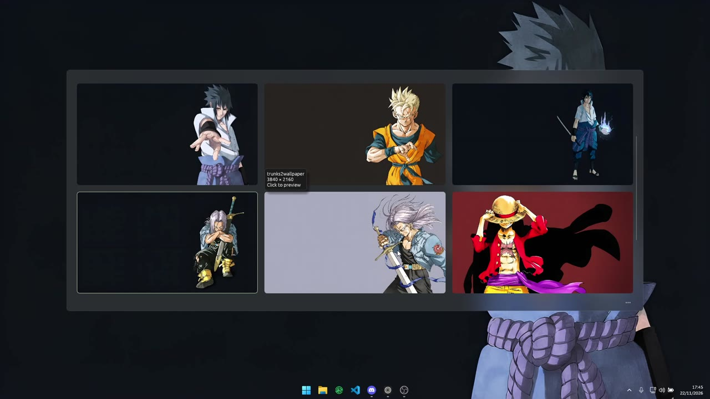

# wall.

[English](README.md)

wall. es un cambiador de fondos de código abierto para Windows 11. Pulsa **Alt+W** para ver tus imágenes y **Enter** para poner la del centro como fondo de escritorio.

## Descargar y abrir

**Windows 11 x64.** No hace falta instalar nada ni tener permisos de administrador.

- [Descarga wall.exe](https://github.com/UnaiSantanaAlonsoDAW/Wall/releases/latest/download/wall.exe) y ábrelo con doble clic.
- Si prefieres el ZIP, descarga `wall-<versión>-windows-x64.zip` desde la [última versión](https://github.com/UnaiSantanaAlonsoDAW/Wall/releases/latest), elige **Extraer todo** y abre `wall.exe` en la carpeta extraída.

Windows puede mostrar un aviso de SmartScreen porque el ejecutable no lleva firma digital.

<picture>
  <source media="(prefers-reduced-motion: no-preference)" srcset="https://raw.githubusercontent.com/UnaiSantanaAlonsoDAW/wall./main/docs/gallery-demo.gif">
  
</picture>

[Descargar la demo de 13 segundos][demo] (MP4 sin audio).

[demo]: https://github.com/UnaiSantanaAlonsoDAW/wall./raw/refs/heads/main/videos/demo.mp4

## Pon tu primer fondo

1. Abre `wall.exe`. Pulsa **Choose images** o **Ctrl+O** y elige imágenes JPEG, PNG o WebP estáticas de tu equipo. También puedes arrastrarlas desde el Explorador al carrusel.
2. Recorre las imágenes con las flechas, la rueda o el panel táctil. Si haces clic en una vista lateral, se mueve al centro.
3. Pulsa **Enter** o haz doble clic en la imagen central para aplicarla. Hasta ese momento solo cambia la vista previa. Windows usa el mismo fondo en todos los monitores y mantiene el ajuste actual de la imagen. Si tienes una presentación de fondos activa, se sustituye al aplicar uno.

La versión en desarrollo incluye **Import folder…** en el menú y en la pantalla vacía. Añade las imágenes compatibles que estén directamente dentro de la carpeta. Si añades más imágenes después, vuelve a importar la carpeta.

## Uso diario

| Atajo | Qué hace |
| --- | --- |
| **Alt+W** | Abre o cierra el carrusel. Se abre en el monitor donde está el puntero. |
| **← / →** | Pasa al fondo anterior o siguiente. |
| **↓** | Abre la galería desde el carrusel o baja una fila en la galería. |
| **↑ / Retroceso** | En la galería, Arriba sube una fila y vuelve al carrusel desde la primera. Retroceso vuelve desde cualquier fila. |
| **Inicio / Fin** | Salta a la primera o última imagen. |
| **Enter** | Aplica el fondo seleccionado y cierra el carrusel. |
| **Esc** | Cierra el carrusel o vuelve desde Preferencias. |
| **Ctrl+O** | Añade imágenes de tu equipo. |
| **Ctrl+,** | Abre Preferencias. |
| **Supr** | Quita la imagen seleccionada de la colección y conserva el archivo original. |
| **Ctrl+Q** | Sale de wall. |

Al cerrar el carrusel, wall. sigue en la bandeja de Windows para que el atajo siga funcionando. Con clic derecho en el icono puedes abrir el carrusel, añadir imágenes, ir a Preferencias o salir.

Usa la galería para ver más imágenes de un vistazo. Desplázate con la rueda, selecciona una miniatura con un clic o aplícala con doble clic. El menú también permite cambiar entre galería y carrusel. Las dos vistas comparten la selección.

En **Preferences** puedes cambiar el atajo, elegir **Glass** (cristal) o **Solid** (opaco) y poner el símbolo de la bandeja en automático, claro u oscuro. El modo automático sigue el tema de la barra de tareas. El cristal viene activado por defecto y puede verse opaco si Windows desactiva la transparencia.

Para que wall. arranque al iniciar sesión, deja el EXE en una carpeta fija, marca **Start with Windows** y guarda. El programa arrancará en la bandeja con el carrusel cerrado. Desmarca la opción y guarda antes de mover o borrar el EXE. Si ya lo moviste, ábrelo desde la nueva carpeta y vuelve a activar la opción.

## Archivos y privacidad

wall. guarda las rutas de tus imágenes en `%LOCALAPPDATA%\wall\collection.json`. Si mueves una imagen, añádela de nuevo desde su nueva ubicación. Puedes hacer una copia de seguridad de la colección y las preferencias guardando ese JSON junto con las imágenes originales que quieras conservar. wall. funciona sin conexión y no envía telemetría.

Para quitar wall., desactiva **Start with Windows**, sal desde la bandeja y borra el EXE o la carpeta extraída. Si también quieres borrar la colección, las preferencias y la caché, elimina `%LOCALAPPDATA%\wall`. Si tienes puesto un WebP desde wall., cambia primero de fondo en Windows, porque puede estar usando una copia convertida que vive en esa carpeta.

## Código, compilación y contribuciones

El proyecto se publica bajo la [licencia MIT](LICENSE). Si encuentras un fallo, [abre una incidencia](https://github.com/UnaiSantanaAlonsoDAW/Wall/issues) e indica tu versión de Windows, la versión de wall. que aparece en Preferencias y qué hiciste antes de que ocurriera.

Para compilar en Windows x64 necesitas Rust 1.99 o posterior con la cadena de herramientas MSVC, y Visual Studio Build Tools con C++ y el SDK de Windows:

```powershell
cargo fmt --all --check
cargo test --locked
cargo clippy --all-targets --locked -- -D warnings
cargo build --release --locked
```

El ejecutable se genera en `target\release\wall.exe`. Ejecuta `./tools/package.ps1` en PowerShell para preparar el ZIP portátil, y `python tools/check_binary.py` para verificar el binario y el paquete. La compilación incrusta los iconos y usa la UCRT incluida en Windows. Los archivos originales de Figma están en [branding](branding) y los recursos generados en [assets](assets).

El [flujo de compilación de Windows](https://github.com/UnaiSantanaAlonsoDAW/wall./actions/workflows/windows.yml) ejecuta las comprobaciones y prepara el EXE portátil, el ZIP y las sumas SHA-256 para `main` y las etiquetas de versión. Puedes descargar estos archivos desde la ejecución correspondiente.

La interfaz usa Rust, egui y OpenGL. Win32 gestiona el atajo global, la bandeja y el monitor donde se abre el carrusel. El cristal Acrylic lo dibuja DWM. Un trabajador en segundo plano cambia el fondo con `IDesktopWallpaper` y guarda las preferencias, y la caché de vistas previas tiene un tamaño limitado. Las [notas de validación](VALIDATION.md) recogen las pruebas, las mediciones y los límites conocidos.
