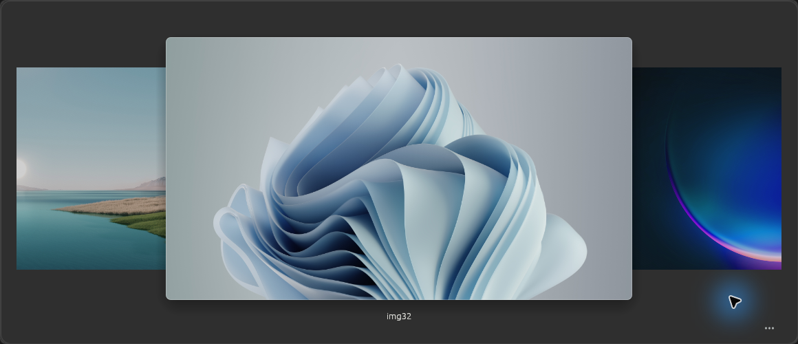

# wall.

[Español](README.es.md)

wall. is a free, open-source wallpaper switcher for Windows 11. Keep your favorite images in one carousel, open it with **Alt+W**, and press **Enter** to put the selected image on your desktop.

## Download and run

**Requires Windows 11, 64-bit (x64).**

- **Quick start:** [Download wall.exe](https://github.com/UnaiSantanaAlonsoDAW/Wall/releases/latest/download/wall.exe), save it somewhere you can find it again, and double-click it.
- **ZIP:** Open the [latest release](https://github.com/UnaiSantanaAlonsoDAW/Wall/releases/latest) and download `wall-<version>-windows-x64.zip` under **Assets**. Right-click the ZIP, choose **Extract All**, and open `wall.exe` in the extracted folder. The ZIP also includes the license and dependency notices.

wall. is portable. It runs without an installer, an account, or administrator access. The release is unsigned, so Windows may show a SmartScreen prompt. Download it from this repository’s Releases page.

## First wallpaper

1. Open `wall.exe`. Click **Choose images** or press **Ctrl+O** to add local JPEG, PNG, or static WebP files. You can also drop files from Explorer onto the carousel.
2. Browse with the arrow keys, the mouse wheel, or your trackpad. Click a side preview to bring it to the center.
3. Press **Enter** or double-click the centered image to set it. Browsing only changes the preview. When you apply an image, Windows uses it on all monitors and keeps its current wallpaper fit. Applying also replaces any active Windows wallpaper slideshow.



## Everyday use

| Shortcut | What it does |
| --- | --- |
| **Alt+W** | Opens or closes the carousel. It opens on the monitor under the pointer. |
| **← / →** | Moves to the previous or next wallpaper. |
| **Home / End** | Jumps to the first or last image. |
| **Enter** | Applies the selected wallpaper and closes the carousel. |
| **Esc** | Closes the carousel or goes back from Preferences. |
| **Ctrl+O** | Adds images from your computer. |
| **Ctrl+,** | Opens Preferences. |
| **Delete** | Removes the selected image from the collection and keeps the original file. |
| **Ctrl+Q** | Quits wall. |

Closing the carousel leaves wall. in the notification area so the shortcut stays available. Right-click the tray icon to open wall., add images, open Preferences, or quit.

In **Preferences** you can change the shortcut, choose **Glass** or **Solid**, and set the tray symbol to automatic, light or dark. **Automatic** follows the Windows taskbar theme. Glass is the default and may fall back to a solid surface when Windows disables transparency.

To start wall. when you sign in, keep the EXE in a permanent folder, select **Start with Windows**, and save. It starts in the tray with the carousel closed. Clear that option and save before moving or deleting the EXE. If you’ve already moved it, open it from the new folder and enable startup there.

## Files and privacy

wall. stores links to your images in `%LOCALAPPDATA%\wall\collection.json`. If you move an image, add it again from its new location. To back up your collection and preferences, copy that JSON file, along with any original images you want to keep. wall. works offline and sends no telemetry.

To remove wall., turn off **Start with Windows**, quit from the tray, and delete the EXE or extracted folder. If you also want to remove the collection, settings, and cached previews, delete `%LOCALAPPDATA%\wall`. Switch to another wallpaper in Windows first if you’re using a WebP through wall., since Windows may be using a converted copy in that folder.

## Source, builds and contributions

wall. is open source under the [MIT License](LICENSE). Bug reports and pull requests are welcome. For Windows-specific issues, include your Windows build, the wall. version from Preferences, and the steps to reproduce the issue. [Open an issue](https://github.com/UnaiSantanaAlonsoDAW/Wall/issues)

Build on Windows x64 with Rust 1.99 or newer using the MSVC toolchain, and Visual Studio Build Tools with the C++ workload and Windows SDK:

```powershell
cargo fmt --all --check
cargo test --locked
cargo clippy --all-targets --locked -- -D warnings
cargo build --release --locked
```

The executable is `target\release\wall.exe`. To create the portable ZIP, run `./tools/package.ps1` in PowerShell. Run `python tools/check_binary.py` to check the executable and package. The build embeds the Windows icon and uses the UCRT already provided by Windows. Original Figma exports live in [branding](branding) and the build uses the generated resources in [assets](assets).

The interface uses Rust, egui and OpenGL. Win32 handles the global shortcut, tray and monitor placement. DWM supplies the Acrylic backdrop. A background worker calls `IDesktopWallpaper` and saves settings, and a separate bounded cache handles previews. See the [validation notes](VALIDATION.md) for testing details, timings and known limits.
