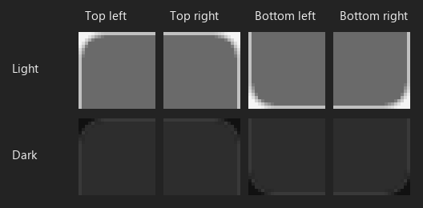

# wall. 0.2.2 on Windows 11

18 November 2026. The Interval is embedded as the Windows executable icon, the tray symbol and the wordmark in Preferences. The existing carousel and Acrylic rendering code carry forward from 0.2.1.

## Brand assets

The Figma directory contains 25 SVGs. Each square group contains six byte-identical exports on a 256 × 256 viewBox. Both app icon tiles have filled rounded backgrounds and transparent outer corners. The Ink and Chalk symbols have transparent backgrounds. The 291 × 120 wordmark uses outlined paths and a rectangular period. No SVG embeds a font, mask or clip path.

The executable uses the supplied dark tile. The tray uses the original standalone Ink and Chalk variants. All three icon groups contain 16, 24, 32, 48 and 256 px frames. The embedded window PNG is 128 px. Preferences shows the original wordmark geometry at 56 logical pixels, rendered from a 2× raster using the supplied Chalk foreground for contrast. The exported SVGs remain in the source checkout. The portable package contains the resources inside the executable.

PE inspection verified all 15 frames byte for byte against the generated ICOs. Windows loaded each size from the embedded icon resources in a native loading check. Both standalone symbols were inspected at 16 px on contrasting backgrounds. The two planes and their diagonal separation remain legible.

## Native checks

- Formatting, Clippy with warnings denied and all 34 tests passed. Tests cover reading legacy or invalid appearance values, persisted settings, tray contrast and actual centering on both attached monitors.
- Inspected the running Windows carousel and Preferences. Glass → Solid → Glass switched without a restart and DWM confirmed Acrylic again. The running tray registered successfully. Both manual symbol choices were exercised, and the updated appearance was written to the isolated collection.
- Enter applied a wallpaper and hid the overlay. The validation guard restored and verified both original wallpapers, positioning and enabled state.
- The x64 GUI build passed PE inspection and ran hidden with 1,000 test references. A duplicate background invocation exited successfully. Over 30.015 seconds the resident process used 0.328 CPU seconds, 79.73 MiB working set and 46.16 MiB private memory.
- The two shell theme mappings were checked in tests. The actual taskbar under both system themes, a mixed-DPI desktop, Windows sign-in and a physical Explorer drop were outside this run.

## Previous release · wall. 0.2.1 on Windows 11

18 November 2026. Windows build 22631, Rust 1.99.1, MSVC x64. The release keeps the existing carousel geometry, typography and native Acrylic treatment.

## Wallpaper latency

Three release trials per version used the same 3840 × 2400 JPEG (826,734 bytes). Neither of the two monitors originally displayed the test file. An instrumented copy of the 0.2.0 source timed the original path. The 0.2.1 harness performed the same current-wallpaper query as opening the carousel, then applied using that worker's connection. Each trial applied the file and restored and verified both original wallpapers, fit and enabled state. Times below are milliseconds from a monotonic clock.

| Version / trial | Prepare file | COM setup on apply | SetWallpaper | Total apply |
| --- | ---: | ---: | ---: | ---: |
| 0.2.0 / 1 | 108.937 | 14.403 | 3.474 | 126.816 |
| 0.2.0 / 2 | 82.960 | 2262.691 | 5.314 | 2350.966 |
| 0.2.0 / 3 | 71.321 | 9.754 | 1.708 | 82.782 |
| 0.2.1 / 1 | 1.295 | 0.002 | 1.576 | 2.874 |
| 0.2.1 / 2 | 1.221 | 0.003 | 1.537 | 2.762 |
| 0.2.1 / 3 | 2.008 | 0.003 | 1.953 | 3.966 |

The earlier version fully decoded this image in the application and opened a new COM connection on each apply. Its slowest measured stage was COM activation. For JPEG and PNG with matching extensions, 0.2.1 checks the file and its dimensions, then gives Windows the original path. The worker lazily creates its connection in its own multithreaded apartment and reuses it. The opening query including initial connection took 8.323–9.316 ms in these three trials. A click before that query completes can still wait in the worker queue. First-time WebP conversion and slow filesystems have separate costs.

In a guarded **interactive debug** run, receipt of the native Enter message to the UI handler took 1.775 ms. Handler entry to worker pickup took 0.079 ms including selection lookup and path cloning. File preparation took 1.870 ms, COM setup 0.013 ms, and the native call 2.510 ms. Total until the worker received the Windows result was 4.493 ms from handler entry. The HWND was hidden after 111.611 ms including the short dismissal and frame scheduling. Applying writes no collection settings and waits for no client animation. The desktop's first visibly repainted frame was not timed. Windows and driver timings may vary.

## Native rendering and interaction

The previous UI painted a 14-logical-pixel rounded tint and an inset outline inside a window already rounded and bordered by DWM. The tint now fills the client area. DWM clips the entire surface once and draws the outer contour. The framebuffer still clears to transparent black and reported 8 alpha bits. Native status reported Acrylic, dark mode and non-client rendering enabled.

The four outer corners were captured after composition over a light and a dark reference window behind the actual overlay. At all four extreme corner pixels the capture matched the reference exactly (244 and 17, respectively). Near-edge interior samples matched their corresponding flat surface (106 and 45). The magnified crops below show the single antialiased contour. The references were controlled solid surfaces, with desktop wallpaper left alone for this comparison.

- Real Enter applied a wallpaper and dismissed the overlay. An absent file returned an error visibly on the same selection. Both interactive test sessions restored the desktop on exit.
- Alt+W reopened the overlay after applying. Repeated toggles, arrows, Preferences and Explorer file selection worked. Four rapid hotkey invocations ended with the overlay visible again. The existing carousel, import worker, texture cache and persisted collection format remain in use.
- Actual hotkey positions on opposite monitors produced centered rectangles of (380, 266)–(1540, 766) and (−1540, 266)–(−380, 766). Both work areas were 1920 × 1032 at 96 DPI. A separate native test placed an invisible HWND from each work area's opposite corners in forward and reverse monitor order. Each pair returned exactly the same centered rectangle. Geometry tests cover different DPI values, taskbar offsets, left/right/above/below arrangements and small displays.
- Client-content opacity moves from 65% to full over up to 110 ms on entry and reverses over up to 65 ms on dismissal. Input is processed during entry. The transition test samples interruption, continuity and immediate reduced-motion endpoints. Hidden startup and duplicate background invocation were exercised. No frame loop runs for a completed transition.
- Preferences exposed the new Start with Windows checkbox. A native registry test enabled, read, retargeted and removed a registration in an isolated volatile key, including a quoted path with spaces and Unicode. The test left the actual Windows Run value untouched. Startup defaults to opt-in and is independent of the collection file.

## Checks and idle use

- Formatting, Clippy with warnings denied, and the Windows release build passed.
- 32 tests passed in the interactive Windows session, including the physical monitor and isolated registry tests.
- Release idle sample with 1,000 fixture references and the overlay hidden, before browsing, measured 0.265625 process CPU seconds in 30.019 seconds (0.885% of one CPU core), 79.40 MiB working set and 45.93 MiB private memory. The second background invocation exited successfully and the resident instance continued running.
- The packaging check validates a 64-bit GUI executable, identical executable bytes inside the ZIP, and the absence of an external Visual C++ runtime requirement. The portable binary is unsigned.

## Validation limits

The UI automation tool refused the final Explorer-to-wall drop because its endpoint belongs to a different application. Explorer focus retention and image import have separate coverage. Both physically attached monitors ran at the same DPI. Mixed-DPI arrangements were exercised through geometry tests. Windows sign-out/sign-in, exclusive fullscreen, global accessibility changes and photon-level desktop refresh timing were outside the measured run.

The workspace contains raw benchmark records in `test-output/polish-measurements` and native logs and original corner captures in `test-output/polish-ui`. The previous release ZIP and the source snapshot remain available for rollback.
